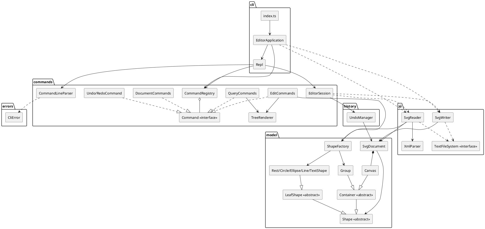
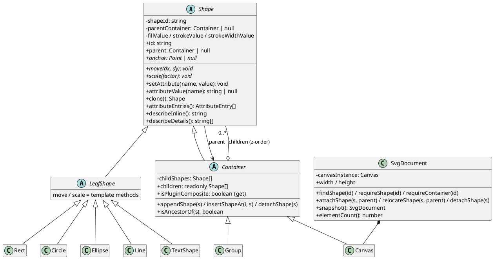

# Lab1 Phase 1：SVG 编辑器（CLI）——架构方案与项目报告

> 本文档是开发过程中的活文档：第 1 节「架构方案」在编码前先确定（阶段 1 提交），
> 第 2～4 节在实现过程中与最终验收时补齐（阶段 7 提交）。文中所有测试结果、
> 命令输出、缺陷与修订均来自本仓库真实执行过程，与 `git log` 相互印证。

- 仓库：<https://github.com/STAMONI/svg-editor-phase1>
- 技术栈：TypeScript（strict）+ Node.js（≥ 20）+ `node:test`，零运行时依赖
- 运行：

```bash
npm install          # 安装 typescript / @types/node 开发依赖
npm run cli          # 编译并进入交互式 REPL（提示符 svg> ）
npm run verify       # 编译 + 依赖方向检查 + 全部自动化测试
node dist/src/index.js examples/flowchart.txt   # 回放脚本，生成 SVG
```

---

## 1. 架构方案

### 1.1 模块划分

代码按「依赖只能向下」的分层组织在 `src/` 下，每个类一个文件（文件名 = 类名）：

| 目录 | 职责 | 主要类 |
|---|---|---|
| `src/errors/` | 统一错误类型，最底层 | `CliError`、`asCliError` |
| `src/model/` | 领域模型：图形对象、类层次、容器树、文档根、几何与属性语义、ID 唯一性、图形工厂 | `Shape`（抽象组件）、`LeafShape`（抽象叶子）、`Rect`、`Circle`、`Ellipse`、`Line`、`TextShape`、`Container`（抽象组合）、`Group`、`Canvas`、`SvgDocument`、`ShapeFactory`（图形工厂）、`Point`、`ShapeType`、`NumberCodec`、`AttributeLookup` |
| `src/io/` | 与外部世界交换数据：XML 解析、SVG 读写、文件访问抽象 | `XmlElement`、`XmlParser`、`SvgReader`、`SvgWriter`、`TextFileSystem`（接口）、`NodeFileSystem`（实现） |
| `src/history/` | 撤销重做（Memento 快照）与「文档类命令后禁止」的锁定语义 | `UndoManager`、`HistoryEntry` |
| `src/commands/` | Command 模式落地：命令接口、具体命令、命令注册与分发、参数解析、会话编排 | `Command`（接口）、`CommandRegistry`、`CommandLineParser`、`EditorSession`，以及 `document/`、`edit/`、`query/`、`history/`、`system/` 下的各具体命令、`TreeRenderer` |
| `src/cli/` | 交互层：REPL、提示符、输出、组合根 | `Repl`、`EditorApplication`（组合根） |
| `src/index.ts` | 进程入口（交互模式 / 脚本回放模式） | — |
| `test/` | 自动化测试（`node --test` 驱动） | 11 个测试文件 + 2 个测试辅助类 |
| `examples/` | 可直接回放的命令脚本、外部 SVG 样例、生成产物 | `flowchart.txt`、`demo.txt`、`other.svg`、`flowchart.svg`、`demo.svg` |
| `scripts/` | 工程质量脚本 | `check-layering.mjs`（依赖方向静态检查）、`run-tests.mjs`（跨 Node 版本的进程内测试运行器） |

### 1.2 组件图（PlantUML）



### 1.3 类层次（PlantUML 类图）

组件图说明「模块怎么切」，下图补充「领域对象怎么组织」，对应附件对
「类层次 + 多态 + 封装」的要求：



要点：几何字段全部私有，外部只能经 `setAttribute`（白名单）/ `attributeValue` 读写；
`LeafShape` 把 `move`/`scale` 收敛为模板方法（子类只实现自己的几何算术）；`Container`
覆写为递归下发，因此命令层对 `g` 与叶子一视同仁。

### 1.4 设计模式的选择与落地

**1) Command 模式（题目强制要求）**

- `src/commands/Command.ts`：命令接口，包含 `name` / `syntax` / `description` /
  `category` / `requiresDocument` / `run(args, session)`。命令只做三件事：
  校验参数、调用领域对象、返回反馈文本。
- **一类一命令一文件**：`InitCommand`、`CreateCommand`、`MoveCommand`、`GroupCommand`、
  `UndoCommand` 等 20 个命令类，互不依赖。
- **Invoker = `EditorSession`**：统一负责「快照 → 执行 → 成功记历史 / 失败回滚」，
  因此「一条编辑命令 = 一个撤销单元」由会话层集中保证，命令本身不需要写逆操作。
- **分发 = `CommandRegistry`**：命令名 → `Command` 实例的查找表（按名分派点之一）。
- `help`、`tree`、`show` 等查询命令同样实现 `Command`，因此「显示命令不进撤销栈」
  只是 `category` 的判定，不需要特殊分支。

**2) Composite 模式（容器与叶子统一操作）**

- `Shape` 是抽象组件；`LeafShape` 是叶子；`Container` 是组合节点，`Group` 是 `g` 的实现。
- `move` / `scale` 在 `Container` 上多态递归到每个子孙；`set` / `delete` / 查询命令只面向
  `Shape` 编程。因此 `move g1 …` 与 `move r1 …` 在命令层完全一致。
- 容器**不保存 SVG transform**，而是递归改写子图形的几何坐标。理由是附件第 3 节明确规定
  `scale`「作用于容器时递归到每个子孙」、`move`「整体平移」，这样 `tree`/`show` 读到的
  永远是真实生效的绝对坐标，且保存出的 SVG 不需要 `transform` 数学。

**3) Memento（快照式撤销）**

- `SvgDocument.snapshot()` 深拷贝整棵图形树；`UndoManager` 保存 `before` / `after` 快照
  与两个方向的操作摘要文本。
- 选择它而不是「每个命令实现逆操作」的原因：`group` / `ungroup` / `addto` / `delete`
  这类结构变更的逆操作极易出错，而快照让它们在会话层天然成为一个原子单元；
  「命令失败不改变任何状态」也变成一次回滚。
- 语义提醒：`undo` / `redo` 会**替换**当前文档对象，任何外部持有的旧引用会失效
  （测试中真实踩到过，见过程记录 2.5）。

**4) Factory（图形工厂，按名分派点之二）**

- `ShapeFactory`（`src/model/ShapeFactory.ts`）是系统**唯一**的图形工厂，只有两个创建入口：
  - `createFromTokens(typeName, id, params)`：CLI 类型名 + 参数 token → 图形（`create` 命令使用）；
  - `createFromSvgElement(localName, id, attributes, content)`：SVG 元素名 + 属性 → 图形
    （`SvgReader` 导入时使用），内部委托各图形类的多态静态工厂 `createFromSvg`。
- 因此系统里**只有两处**按名字分派：`CommandRegistry`（命令名 → 实现）与 `ShapeFactory`
  （图形类型 / 元素名 → 类），符合附件「按名字分派只允许两处」的要求。阶段 10 的作业审计
  合并了此前独立的 `SvgElementFactory`（导入侧注册表），避免出现第三个分派点；工厂放在
  `model` 层，使 `commands` 与 `io` 都能依赖它而不违反分层。
- `create box` 在同一工厂中统一报 `unknown shape type: box (is the plugin loaded?)`。
- 两处均标注为**待重构点**：插件化阶段会用 `ShapeProvider` 注册表替换图形工厂，
  `box` 等新类型无需修改内核。

### 1.5 依赖方向规则

```
errors  ←  model  ←  io  ←  commands  ←  cli
                  ←  history  ←  commands
```

| 允许的依赖 | 理由 |
|---|---|
| 任意层 → `errors` | 错误类型是所有层的公共词汇，且不反向依赖任何东西 |
| `model` → `errors` | 领域对象抛出统一错误 |
| `io` → `model`, `errors` | 读写器必须认识领域对象 |
| `history` → `model`, `errors` | 快照保存的是文档对象 |
| `commands` → `model`, `io`, `history`, `errors` | 命令是编排层 |
| `cli` → `commands`，以及为「组合根」装配所需的更低层（`io` / `model` / `errors`） | 组合根在进程入口装配全部实现；`cli` 不写业务逻辑、不操作领域对象状态 |
| `src/index.ts` → `cli` | 入口只启动应用 |

禁止的依赖（违反即为待处理项）：

- `model` 不得依赖 `io` / `commands` / `cli` / `history`；
- `io`、`history` 不得依赖 `commands` / `cli`；
- `commands` 不得依赖 `cli`；
- 具体命令类之间不得互相 import（复用一律下沉到 model / session）；
- `cli` 不得绕过 `EditorSession` 直接修改文档。

检查手段：`scripts/check-layering.mjs` 扫描 `src/**/*.ts` 的静态 import 并断言上述规则，
`npm run verify` 会执行它（真实输出见第 4 节）。

### 1.6 变化点假设

| 变化点 | 假设 | 是否预留扩展点 |
|---|---|---|
| 图形类型扩展（插件化 `box`） | 下一阶段引入 `ShapeProvider` 插件注册表 | 是：工厂集中在唯一的 `model/ShapeFactory`（CLI 与 SVG 两个入口）；`Container.isPluginComposite` 钩子让 `box` 可继承容器并拒绝 `ungroup`；`ungroup` 已按「插件复合类型拒绝解散」实现 |
| 命令语法增加 | 命令会继续增加 | 是：命令自包含解析与校验，`CommandRegistry` 注册即生效，`help` 自动列出 |
| 显示格式调整 | `tree` / `show` 排版可能改 | 是：格式收敛在 `Shape.describeInline()` / `describeDetails()` 与 `TreeRenderer` |
| 序列化标记（`data-kind`） | 插件类型需要持久化标记 | 部分：`Shape.attributeEntries()` 由子类决定属性，插件可在子类中增加 `data-kind`；本阶段内置类型不写额外标记 |
| 持久化后端变化 | 换存储实现 | 是：`TextFileSystem` 接口 + `NodeFileSystem` 实现，测试用内存实现 |
| undo 策略 | 图形数量大时快照变重 | 否（有意取舍）：本阶段规模小，快照换取正确性；将来可在 `UndoManager` 内替换为逆操作而不影响命令与界面 |
| 画布/坐标变换 | 若未来需要 SVG `transform` | 否（有意不留）：本阶段需求要求绝对坐标语义；若引入 transform，`move`/`scale` 与 `show` 需同时改，属于跨层变更，过早抽象反而增加复杂度 |

### 1.7 命令与实现对照

| 命令 | 实现类 | category |
|---|---|---|
| `init` | `document/InitCommand` | document |
| `read` | `document/ReadCommand` | document |
| `save` | `document/SaveCommand` | document |
| `canvas` | `document/CanvasCommand` | query / document（按有无参数动态判定） |
| `create` | `edit/CreateCommand` + `model/ShapeFactory` | edit |
| `delete` | `edit/DeleteCommand` | edit |
| `move` | `edit/MoveCommand` | edit |
| `scale` | `edit/ScaleCommand` | edit |
| `set` | `edit/SetCommand` | edit |
| `group` | `edit/GroupCommand` | edit |
| `ungroup` | `edit/UngroupCommand` | edit |
| `addto` | `edit/AddToCommand` | edit |
| `front` / `back` | `edit/FrontCommand` / `edit/BackCommand` | edit |
| `tree` / `show` | `query/TreeCommand` + `TreeRenderer` / `query/ShowCommand` | query |
| `help` | `query/HelpCommand` | query |
| `undo` / `redo` | `history/UndoCommand` / `history/RedoCommand` | history |
| `exit`（便利命令，非附件要求） | `system/ExitCommand` | query |

### 1.8 错误信息契约（附件 4.2 的逐条落地）

所有错误统一以 `error:` 开头（由 REPL 添加前缀，`CliError` 本身不含前缀），一行一条，
且命令失败不改变任何状态（会话层异常回滚）。下表是附件错误表与实现/测试的对照：

| 场景（附件 4.2） | 实际输出 | 产生位置 | 契约测试 |
|---|---|---|---|
| id 已存在 | `error: id already exists: r1` | `SvgDocument.assertIdAvailable` | `ErrorMessageContract` |
| id 不存在 | `error: no such shape: r9` | `SvgDocument.requireShape` | `ErrorMessageContract` |
| `in` 目标不存在 | `error: no such container: node9` | `SvgDocument.requireContainer` | `ErrorMessageContract` |
| `in` 目标不是容器 | `error: not a container: start` | `SvgDocument.requireContainer` | `ErrorMessageContract` |
| 未注册的图形类型 | `error: unknown shape type: hexagon (is the plugin loaded?)` | `ShapeFactory.create` | `ErrorMessageContract` |
| ungroup 复合图形 | `error: cannot ungroup composite shape: n1` | `UngroupCommand`（`isPluginComposite` 钩子；用测试替身覆盖） | `ErrorMessageContract` |
| group 目标含容器与其子孙 | `error: cannot group a container into its own descendant: g1` | `GroupCommand` | `ErrorMessageContract` |
| ungroup 根级容器 | `error: cannot ungroup top-level container: scene` | `UngroupCommand` | `ErrorMessageContract` |
| scale 非正数 | `error: scale factor must be positive` | `ScaleCommand` | `ErrorMessageContract` |
| 文件不存在 / 不可写 | `error: cannot read file: a.svg` / `error: cannot write file: a.svg` | `SvgReader` / `SvgWriter` | `ErrorMessageContract` |
| 未 read/init 就执行其他命令 | `error: no document. use 'init' or 'read' first` | `EditorSession.execute` | `ErrorMessageContract` |
| 白名单之外的属性 | `error: unknown attribute: opacity` | `Shape.setAttribute` | `ErrorMessageContract` |
| id 含空白（本实现扩展校验） | `error: invalid id: a b` | `Shape` 构造器 | `ErrorMessageContract` |
| 文档类命令后 undo/redo | `error: undo not allowed after io command`（redo 同构） | `UndoManager.assertUnlocked` | `ErrorMessageContract` |

说明：`box` 属后续插件阶段，本阶段不会出现真正的复合图形对象；`cannot ungroup composite shape`
用测试内的 `FakePluginComposite`（继承 `Container`、`isPluginComposite = true`）验证钩子契约，
未向内核加入任何未要求的类型。

---

## 2. 过程记录

以下记录按真实提交顺序整理，提交见 `git log --oneline`。

### 2.1 阶段 1：环境确认与脚手架（`docs: add initial architecture plan and TypeScript project scaffold`）

- 实际检查：`main` 分支、`origin` 已配置、仓库无提交、工作区为空；Node v24.21.0 / npm 11.19.0 可用；
  `npx tsc` 不可用，需要本地安装 TypeScript。
- 发现的环境问题（真实遇到并解决）：
  1. npm 全局缓存在沙箱工作区之外，安装时报 `EPERM`。解决：把缓存重定向到工作区
     （`npm --cache .npm-cache install`），并把 `.npm-cache/` 写入 `.gitignore`。
  2. GitHub 访问在本机默认 `schannel` 后端下报
     `schannel: AcquireCredentialsHandle failed: SEC_E_NO_CREDENTIALS`，Clash 代理配置
     也会导致 `Recv failure: Connection was reset`；实测「`openssl` 后端 + 经 Clash 代理」
     可以正常推送，因此每次推送只用命令行临时参数 `-c http.sslBackend=openssl`，
     **没有改动任何全局 Git 配置、没有关闭 TLS 校验**。
  3. Git 通过 `sh.exe -c 'git credential-manager get'` 调用凭据助手，受限沙箱下 MSYS2 无法
     创建 signal pipe（Win32 error 5），导致无法读取已保存的 GitHub 凭据；推送时按需申请
     完整执行权限完成，凭据本身未被读取或输出。
- 决策：先写架构方案（模块划分、依赖规则、变化点），再开始编码；`doc/README.md` 初版只有
  第 1 节，其余三节标注「待实现阶段补充」。

### 2.2 阶段 2：核心对象模型（`feat: implement SVG document and shape model`）

- 关键决策：几何字段全部私有，统一经 `setAttribute`（白名单）写入；属性 setter/getter 以
  带名字的绑定注册，而不是在基类里 `switch(tag)`；`SvgDocument` 成为唯一树变更入口
  （`attachShape` / `relocateShape` / `detachShape`），保证 ID 全局唯一。
- 关键决策：容器不保存 transform，`move` / `scale` 递归到叶子。依据是附件对
  `scale`「作用于容器时递归到每个子孙」的规定，以及 `tree`/`show` 应显示真实坐标。
- 测试：`test/model/DocumentModel.test.ts` 12 项（父链、ID 唯一/大小写敏感、递归移动缩放、
  属性白名单、快照深拷贝、画布尺寸校验），`npm run build` + `node --test` 全绿。
- 环境说明：`node --test` 默认给每个测试文件起子进程，本机受限环境下子进程管道被拒
  （`spawn EPERM`），因此阶段 2～8 的测试脚本使用 `--test-isolation=none`（同进程执行，仍是
  官方 runner）。阶段 9 发现该参数只存在于 Node ≥ 22.8，已改为 `scripts/run-tests.mjs`
  （进程内运行，Node ≥ 20 通用），见 2.9。

### 2.3 阶段 3：Command 模式与基础命令（`feat: implement core CLI commands`）

- 实现 `Command` 接口、`CommandRegistry`、`CommandLineParser`（含双引号/转义/`#` 注释）、
  `EditorSession`（快照回滚）、`ShapeFactory`、`init` / `create` / `delete` / `move` /
  `scale` / `set`。
- 真实发现的缺口：`set` 的成功摘要与撤销摘要需要「旧值」，而阶段 2 的属性绑定只有 setter。
  于是给 `Shape` 增加 `attributeValue(name)`，属性绑定升级为 setter+getter。这是需求驱动
  的模型修订，不是预先设计。
- 测试：新增解析器测试与基础命令测试，总数到 28 项全绿。

### 2.4 阶段 4：复合图形操作（`feat: implement composite shape operations`）

- 实现 `group` / `ungroup` / `addto` / `front` / `back`，以及 `create … in <containerId>`。
  `group` 的插入位置取「第一个被收编图形原位置」，被收编图形按命令行顺序进入新容器。
- 边界处理：`group` 的循环包含（容器 + 其子孙）用父链判定 `isAncestorOf`；`addto` 禁止把
  容器移入自己的子孙；`ungroup` 拒绝非容器、顶层容器、以及插件复合类型
  （`Container.isPluginComposite` 钩子）。
- 真实修正：阶段 3 的一条测试曾期望 `create rect … in g1`（g1 不存在）报参数错误；加入 `in`
  子句后错误优先级调整为「先校验容器、再校验参数」，因此同步更新了那条测试期望——
  这次修订与提交同步可见，不是事后伪造。
- 代码质量自查：`GroupCommand` 初稿把一个 `import` 写在了文件尾部并用别名，属于不良写法，
  在提交前重写为常规顶部 import（教训：AI 生成的这类「能编译但不规范」的代码需要人工复核）。

### 2.5 阶段 5：撤销重做与 SVG 读写（`feat: add undo redo and SVG persistence`）

- `UndoManager`（Memento）+ 会话层历史登记；文档类命令（`init` / `read` / `save` /
  `canvas` 改尺寸）执行后 `resetAndLock()`，`undo`/`redo` 报
  `error: undo not allowed after io command`，直到下一条编辑命令重新解禁。
- 真实缺陷（测试发现）：`undo`/`redo` 用快照替换文档对象后，测试里缓存的旧 `document`
  引用失效，出现 `Cannot read properties of undefined (reading 'map')`。确认这是 Memento
  语义的正确行为，修正测试为每次重新读取 `session.document`，并在本文档 1.4 节记录该语义。
- 真实修正：`canvas` 无参数时是查询、有参数时是文档级命令；若把 `category` 写死会导致
  「查询也会锁历史」。于是给 `Command` 增加可选的 `categoryFor(args)`，由会话层动态判定。
- 读入侧设计：为避免出现第三处 `switch(tag)`，每个图形类增加多态静态工厂
  `createFromSvg(id, attributes)`，当时由独立的 `SvgElementFactory` 注册表消费（阶段 10 审计时
  已并入唯一的 `model/ShapeFactory`，见 2.10）；XML 解析器自研（无第三方依赖），支持
  声明/注释/CDATA/DOCTYPE/实体/命名空间前缀。
- 测试：新增 `UndoRedo`（11 项）与 `SvgPersistence`（9 项），总数到 56 项全绿。

### 2.6 阶段 6：查询命令与测试完善（`feat: add tree/show/help queries with full CLI test coverage`）

- 实现 `tree`（`TreeRenderer`：全局对齐列宽、子树、容器内联样式）、`show`（父容器 + 分组属性）、
  `help`（从注册表自动生成分组语法表）。
- 真实缺陷（测试发现）：手算 `tree` 对齐列宽错误（我按 36 列写期望，实际 32 列），
  测试失败后修正；同时发现 `line` 的 `stroke=black` 在附件示例的树里没有显示，而当时实现
  显示了所有显式样式属性，于是决定**保留显示**（信息更完整）。阶段 10 对照附件重新审计后
  改为与示例一致：`tree` 只内联 `fill`，`stroke` 等完整样式由 `show` 展示（见 2.10）。
- 真实缺陷（脚本自检发现）：`check-layering.mjs` 初版误报 `history → errors`（规则漏写）和
  `src/index.ts` 层名未知（入口文件未归类）；修正规则后输出 `layering check passed (53 files)`。
- 真实环境问题：用 PowerShell 5.1 的 `Get-Content` 查看生成 SVG 时中文乱码，一度怀疑编码
  错误；用 Node 显式 UTF-8 读取确认文件本身正确（无 BOM、`开始`/`处理数据 v2` 均在），
  再用 CLI `read` 回读，中文完整。结论：显示端问题，代码无需修改。
- 新增 `examples/flowchart.txt`、`examples/demo.txt`、`examples/other.svg`，用编译后的真实 CLI
  回放验证（输出见第 4 节）。

### 2.7 阶段 7：文档复核与最终验收（`docs: complete project report and validation`）

- 对照附件逐条复核命令表、错误信息表、显示格式、undo 规则、阶段边界（`box` 必须报
  `unknown shape type`）。
- 统一执行 `npm run verify`：编译通过、依赖检查通过、67 项测试全绿（真实输出见第 4 节）。
- 补齐本文档第 2～4 节，并按 3.1 的修订记录更新了架构方案中的模块清单与依赖规则。

### 2.8 阶段 8：交付强化——错误契约与边界测试（`test: verify documented error messages and edge cases`、`docs: enrich diagrams and acceptance evidence`）

- 动机：用户要求「再更新或丰富一些内容，但不要超出作业的界限」。因此本阶段**不新增任何功能**：
  不实现 `box`、不增加未列出的命令、不改需求语义，只补强「需求符合性证据」与文档可读性。
- 新增 `test/errors/ErrorMessageContract.test.ts`：把附件 4.2 的 13 类错误信息逐条与真实输出
  做逐字比对（含 `cannot ungroup composite shape` 钩子契约），把「看起来实现了」变成
  「逐条可验证」。
- 新增 `test/cli/CompositeEdgeCases.test.ts`（6 项）：`ungroup` 在被解散容器的原位置提升子节点、
  跨父容器 `group`、`addto` 追加顺序、嵌套容器 `front`/`back`、容器缩放的整体撤销、
  深层嵌套结构删除后撤销还原。
- 新增 `test/io/SvgImportEdgeCases.test.ts`（7 项）：未知元素（`title`/`desc`/`defs`/`path`）跳过、
  `viewBox`/默认尺寸回退、单引号属性/注释/CDATA、实体解码、深层嵌套、导入属性的可编辑性、
  `transform`/`style` 等未支持属性被忽略。
- 真实缺陷：上述新测试首轮运行有 2 项失败，原因都是**测试自身的假设错误**而非实现缺陷——
  (1) 我一开始把待 `ungroup` 的容器建成了顶层容器，触发了附件要求的
  `cannot ungroup top-level container`；(2) 用 `requireShape` 探测不存在的 id，而该方法按契约
  抛错而不是返回 `null`（应使用 `findShape`）。两处都修正测试，未改动实现。
- 测试总数 67 → 83，全部通过；文档新增类图、错误契约表、验收清单，并更新测试/检查数字。

### 2.9 阶段 9：可运行性加固——修复真实运行问题（`fix:` / `test:` / `docs:` 三个提交）

- 动机：用户要求「修复所有错误，一定要能正常运行」。于是按「全新克隆」的方式做了一次端到端自查：
  删除 `node_modules`、`dist` 后重新 `npm install` → 构建 → 全量测试 → 真实 CLI 运行，
  并补测异常输入与外部 SVG，发现并修复了以下真实问题。
- **缺陷 1（功能错误）**：`<svg width="100%" height="100%" viewBox="0 0 300 200">` 被读成
  100×100 画布。原因是尺寸解析用前缀正则把 `100%` 当成了 `100` 像素。修复：百分比长度视为
  「未给出」，回退到 `viewBox`（再回退 800×600），并补两条测试（百分比回退、`px` 单位）。
- **缺陷 2（可移植性错误）**：测试脚本使用 `node --test --test-isolation=none`，该参数仅 Node
  ≥ 22.8 支持，旧版 Node 上 `npm test` 直接报参数错误；而普通 `node --test` 又会为每个文件
  起子进程（受限环境 `spawn EPERM`）。修复：新增 `scripts/run-tests.mjs`，在**同一进程**内
  `import` 全部 `dist/test/**/*.test.js`，仍由 `node:test` 报告结果与设置退出码；`npm test` /
  `npm run verify` 改为调用它，Node ≥ 20 均可运行。用一个故意失败的临时测试验证过
  「失败时退出码为 1」，确认没有削弱 CI 能力。
- **缺陷 3（显示错误）**：文本内容里的引号/换行/制表符在 `tree`、`show` 中未转义，
  形如 `"say "hi""`，导入多行文本时还会破坏树形布局。修复：输出时统一转义为
  `"say \"hi\""`、`first\nsecond`，保存/读取仍保持原始内容。
- **缺陷 4（健壮性）**：`create g "a b"` 这类含空白的 id 会被接受，保存后产生无法被
  CSS/URL 片段寻址的 SVG 属性。修复：构造图形时校验 id 不允许空白，报 `invalid id: a b`；
  导入含空白 id 的外部 SVG 按 `invalid SVG` 处理。
- **缺陷 5（健壮性）**：输出管道被提前关闭（如 `| head`）时可能报 `EPIPE` 崩溃；入口增加
  对 stdout `EPIPE` 的静默退出处理。
- **缺陷 6（交互可靠性）**：交互模式原先用 `for await` 迭代 readline 再手动 `prompt()`，
  在真实终端下提示符重绘不够稳。修复：交互模式改为标准 `line` 事件 + `rl.prompt()` 循环，
  管道/脚本模式仍是不回显、不打印提示符。
- 验证：清空 `node_modules`/`dist` 后重新 `npm install` + `npm run verify` 全绿（88 项测试）；
  `npm run cli`、管道 REPL、`node dist/src/index.js examples/flowchart.txt`、
  `examples/demo.txt` 全部真实运行通过。
- 测试总数 83 → 88（新增百分比回退、px 单位、空白 id、文本转义、多行文本 5 项），无功能范围变化。

### 2.10 阶段 10：对照附件逐条审计与提交流程补齐（`refactor:` / `docs:` 两个提交）

- 动机：用户要求「检查是否作业内的所有要求均已达到」。于是按附件章节逐条核对命令表、通用约定、
  实现范式、错误表、显示格式与 git 要求，发现 **3 处与附件严格表述不一致**（功能行为本身正确，
  但形式/结构未完全贴合）：
  1. **`tree` 显示格式**：此前内联了显式设置的 `stroke` / `stroke-width`，与附件 5.1、6.1 的
     示例输出不完全一致（示例中 line 只显示坐标）。修复：`tree` 只内联几何属性 + `fill`
     （与示例逐字一致），`stroke` 等完整样式由 `show` 展示；同时在流程图验收用例中增加
     `show arrow1` 断言，保证信息没有丢失。
  2. **按名分派点数量**：附件只允许两处（命令分发、图形工厂），此前实际存在三个注册表
     （命令、CLI 图形工厂、SVG 元素工厂）。修复：合并为唯一的 `model/ShapeFactory`，提供
     `createFromTokens` 与 `createFromSvgElement` 两个入口，分派点回到两处；工厂下沉到
     `model` 层使 `commands` 与 `io` 都能依赖且不违反分层。
  3. **类文件中的自由函数**：`asCliError`、`countDescendants` 是散落的自由函数。修复：分别
     收进 `CliError.normalize` 静态方法与 `Container.descendantCount` 方法，强化「一类一文件 +
     类封装」的实现范式。
- 补测 7 项契约用例：`read` 后 undo 锁定、显示命令不清空 redo、注释/空行无输出、容器 `set`
  样式、未设置 `fill`/`stroke` 时保存不写该属性、带空格路径的 save/read、`tree` 只含 fill 而
  `show` 含 stroke。
- 结果：测试 88 → 95 全绿；依赖检查 `layering check passed (52 files)`；其他要求复核后未发现
  新的不一致。

---

## 3. 一致性自查

### 3.1 模块划分：实际目录与方案是否一致？

**结论：主体一致，存在少量实现期细化，均已在本节记录修订。**

| 方案初版 | 实际实现 | 说明 |
|---|---|---|
| `io/FileSystem` 一件事 | `TextFileSystem`（接口）+ `NodeFileSystem`（实现） | 接口与实现分离，测试用内存实现替换 |
| 未列出（阶段 5 引入） | `model/ShapeFactory`（阶段 10 从 `commands/factories/ShapeFactory` 与 `io/SvgElementFactory` 合并而来） | 唯一的图形工厂，含 CLI 与 SVG 两个创建入口；保证按名分派只有两处 |
| 未列出 | `model/Point`、`model/NumberCodec`、`model/AttributeLookup` | 值对象与数值/属性读取工具，属细节类 |
| 未列出 | `commands/query/TreeRenderer` | `tree` 的排版渲染，从命令中抽出便于单测与复用 |
| 未列出 | `commands/document/CanvasCommand`、`history/UndoCommand`、`history/RedoCommand`、`system/ExitCommand` | 阶段 4～6 实现过程中新增的命令 |
| `cli` 只依赖 `commands` | `cli/EditorApplication` 作为组合根，直接装配 `io` 实现 | 组合根例外，已写入 1.5 规则；`cli` 仍不写业务逻辑 |

目录实际布局与 1.1 节所列为准（阶段 7 已按实际实现更新 1.1、1.2、1.5、1.7 节；阶段 8 又补充了
1.3 类图与 1.8 错误契约表；阶段 10 按审计结果更新 1.1、1.2、1.4、1.8，因此该节编号在阶段 10
之后为 1.1 / 1.2 / 1.3 / 1.4 / 1.5 / 1.6 / 1.7 / 1.8）。

### 3.2 依赖方向：方案规则有没有被违反？

**结论：未发现违反，且有可重复执行的静态检查。**

- 检查手段：`node scripts/check-layering.mjs`，扫描 `src/**` 的所有静态 `import`，按
  errors < model < io/history < commands < cli < entry 的允许矩阵断言。
- 实际执行结果：`layering check passed (53 files)`（退出码 0）。
- 抽样人工检查：
  - `src/model/Shape.ts` 只 import `../errors/CliError`、同层模块与 `./Point` 类型；
  - `src/io/SvgReader.ts` 只 import `../model/*`、`../errors/*` 与同层 `./*`；
  - `src/commands/edit/*` 之间没有任何互相 import（`GroupCommand` 重写后符合）；
  - `src/cli/Repl.ts` 只依赖 commands 层的类型，不 import model / io；
  - 会话层 `EditorSession` 不 import 任何具体命令类。
- 已知的「有意例外」只有组合根 `src/cli/EditorApplication.ts`（装配 `NodeFileSystem`、
  `SvgReader`、`SvgWriter`），已在 1.5 节写明并作为允许规则的一部分。

---

## 4. 质量保证手段

### 4.1 编译与类型检查

- `tsconfig.json`：`strict`、`noImplicitOverride`、`noUnusedLocals`、`noUnusedParameters`、
  `noFallthroughCasesInSwitch`、`forceConsistentCasingInFileNames`，目标 ES2022 / CommonJS。
- 每个阶段提交前都实际执行 `npm run build`（tsc），全部通过；阶段 10 最终执行
  `npm run verify`（构建 + 依赖方向检查 + 95 项测试），全部通过。

### 4.2 自动化测试

运行方式：`npm test`（编译后执行）或 `npm run verify`（编译 + 依赖检查 + 测试）。
测试框架为 Node 内置 `node:test` + `node:assert/strict`，无第三方测试依赖；
`test/support/EditorHarness` 复用真实的组合根，用内存文件系统替换磁盘 IO。
测试入口是 `scripts/run-tests.mjs`：它在**同一进程**内依次 `import` 编译后的
`dist/test/**/*.test.js`，不依赖 `node --test` 的逐文件子进程，也不依赖只在 Node ≥ 22.8
才存在的 `--test-isolation` 参数，因此 Node ≥ 20 都能直接运行；失败时 `node:test` 仍会设置
非零退出码（阶段 9 用注入失败用例实测验证过）。

| 阶段 | 测试数量 | 结果 |
|---|---|---|
| 2 模型 | 12 | 全绿 |
| 3 基础命令 | 28 | 全绿 |
| 4 复合操作 | 37 | 全绿 |
| 5 撤销/持久化 | 56 | 全绿 |
| 6 查询与最终 | 67 | 全绿 |
| 8 交付强化（错误契约 + 边界） | 83 | 全绿 |
| 9 运行性修复（百分比尺寸、文本转义、空白 id 等） | 88 | 全绿 |
| 10 需求审计与格式对齐（tree 格式、单一工厂、契约补测） | 95 | 全绿 |

覆盖附件第 5 节的 10 类验收场景：

| 验收场景 | 测试文件 |
|---|---|
| 1. 建画布、创建图形、改属性、保存 SVG | `test/io/SvgPersistence.test.ts`、`test/cli/BasicCommands.test.ts` |
| 2. 读取外部 SVG 并自动补 ID（含警告） | `test/io/SvgPersistence.test.ts` |
| 3. 图形树与属性查询 | `test/cli/QueryCommands.test.ts` |
| 4. 分组、解散、移入容器、层级调整 | `test/cli/CompositeCommands.test.ts` |
| 5. 容器移动/缩放时子图形行为 | `test/model/DocumentModel.test.ts`、`test/cli/FlowchartCase.test.ts` |
| 6. undo/redo、redo 栈清空、文档类命令限制 | `test/cli/UndoRedo.test.ts` |
| 7. 重复 ID、非法参数、非法属性、无效容器、循环包含 | `test/cli/BasicCommands.test.ts`、`test/cli/CompositeCommands.test.ts` |
| 8. 文件不存在、保存失败 | `test/io/SvgPersistence.test.ts` |
| 9. 保存后重新读取一致性 | `test/io/SvgPersistence.test.ts`、`test/cli/FlowchartCase.test.ts` |
| 10. 两节点流程图案例 | `test/cli/FlowchartCase.test.ts`（逐行比对 `tree` 输出） |
| 补充：附件 4.2 全部错误信息逐字契约 | `test/errors/ErrorMessageContract.test.ts` |
| 补充：复合操作边界（跨父分组、位置提升、嵌套 z-order、缩放撤销） | `test/cli/CompositeEdgeCases.test.ts` |
| 补充：SVG 导入边界（未知元素、viewBox 回退、引号/CDATA/实体、忽略属性） | `test/io/SvgImportEdgeCases.test.ts` |
| 补充：百分比尺寸回退 viewBox、px 单位、空白 id 拒绝、文本转义/多行 | `test/io/SvgImportEdgeCases.test.ts`、`test/cli/QueryCommands.test.ts`、`ErrorMessageContract.test.ts` |
| 补充：显示格式（tree 只内联几何+fill，show 含完整样式） | `test/cli/QueryCommands.test.ts`、`test/cli/FlowchartCase.test.ts` |

异常/边界专项：未初始化文档、未闭合引号、非法数字、非正缩放、未知属性、`box` 未注册、
顶层容器不能 ungroup、容器入自身子孙、文件不可写、非法 XML、重复 ID 读入、中文文本往返、
插件复合类型 `ungroup` 钩子契约、未支持元素/属性静默跳过、注释/空行、带空格文件路径、
未设置样式不写属性、显示命令不清空 redo 栈。

### 4.3 手动 CLI 验证（真实输出摘录）

`node dist/src/index.js examples/flowchart.txt`（两节点流程图，实际输出）：

```text
canvas 800x600 created
g#flowchart created
g#node1 created in g#flowchart
rect#start created in g#node1
text#start-label created in g#node1
g#node2 created in g#flowchart
rect#process created in g#node2
text#process-label created in g#node2
line#arrow1 created in g#flowchart
svg (800x600)
└── g#flowchart
    ├── g#node1
    │   ├── rect#start          x=120 y=100 w=160 h=60 fill=#4a90d9
    │   └── text#start-label    (155,135) "开始"
    ├── g#node2
    │   ├── rect#process        x=520 y=100 w=160 h=60 fill=#f5a623
    │   └── text#process-label  (545,135) "处理数据"
    └── line#arrow1             (280,130) -> (520,130)
g#node2 moved by (0,100)
g#node2 moved back by (0,-100)
text#process-label updated: text="处理数据 v2"
saved to examples/flowchart.svg (8 elements)
```

该 `tree` 输出与附件 6.1 的示例逐字一致（`line` 的 `stroke` 只出现在 `show arrow1` 的明细里）。

`README` 中 `examples/flowchart.svg` 即该次运行生成，可直接用浏览器打开预览（合法 SVG，
无 BOM，UTF-8）。用 CLI `read examples/flowchart.svg` 回读后 `tree` 输出与原树完全一致。

`node dist/src/index.js examples/demo.txt` 覆盖了：创建/分组/查询/撤销/重做/z-order/
`addto`/`ungroup`/非法命令/画布查询与改尺寸/保存/读入外部 SVG（含缺 ID 警告），
输出与附件第 6 节示例一致（其中 `tree` 的示例树逐字符一致）。

### 4.4 回归与工程化检查

- 回归：每个阶段都在前一阶段测试全绿的基础上追加新测试，从未出现「修新坏旧」后未修复的提交；
  保存→读取往返、中文往返、撤销→重做往返均作为回归用例固化。
- 依赖方向检查：`npm run check:layering`（`layering check passed (53 files)`）。
- 提交纪律：共 15 个提交（7 个阶段 + 阶段 8 的 3 个强化提交 + 阶段 9 的 3 个可运行性修复提交
  + 阶段 10 的 2 个审计对齐提交）逐提交推送；每个提交前实际执行构建与测试；提交信息与内容对应，
  未使用 `reset --hard` / 强制推送分支 / 空提交 / 修改提交时间。
  `final` 标签在阶段 8、阶段 9、阶段 10 之后均被移动到最新提交（仍是同一条线性历史的末端，
  **没有重写或压缩历史**）。

### 4.5 需求验收清单（附件逐条对照）

| 附件要求 | 落地情况 | 证据 |
|---|---|---|
| 仅六种内置类型（rect/circle/ellipse/line/text/g），`box` 属插件阶段 | 六种全部实现；`create box` 报未注册类型错误，未越界实现 | `ShapeType`、`ShapeFactory`、`ErrorMessageContract` |
| 图形（含容器）唯一且大小写敏感 id，命令一律用 id 定位 | 全局唯一性与大小写敏感由 `SvgDocument` 保证 | `DocumentModel.test.ts` |
| `create`/`group` 的 id 必填；读入缺 id 按标签名+序号自动补并打印 warning | 已实现，警告格式 `warning: assigned id rect1 to unnamed <rect>` | `SvgPersistence.test.ts` |
| 所有创建命令支持 `in <containerId>` | `create … in` 已实现并校验容器存在且为 `g` | `CompositeCommands.test.ts`、`QueryCommands.test.ts` |
| 容器与叶子统一操作（move/scale/delete/set），嵌套结构正确 | Composite 多态递归；嵌套/跨父/位置提升均有测试 | `CompositeEdgeCases.test.ts`、`FlowchartCase.test.ts` |
| `set` 仅允许白名单属性，白名单外报 `unknown attribute` | 白名单由各图形类的属性绑定决定 | `DocumentModel.test.ts`、`ErrorMessageContract` |
| 错误统一 `error:` 前缀、命令失败不改变状态 | 会话层快照回滚；13 类错误逐字契约测试 | `ErrorMessageContract.test.ts`、`BasicCommands.test.ts` |
| 成功编辑命令输出摘要，显示命令直接输出内容 | 各命令返回反馈行；`tree`/`show`/`help` 只读 | CLI 测试与 `examples/demo.txt` 实测输出 |
| undo/redo：一命令一单元、复合整体撤销、显示命令跳过、文档类命令后禁止、新编辑清空 redo | 全部实现并用测试锁定 | `UndoRedo.test.ts` |
| 两节点流程图案例可按附件命令顺序构建 | 命令顺序与树输出逐行比对通过 | `FlowchartCase.test.ts` |
| 命令总表 19 条命令、语法与反馈格式 | 全部实现；`help` 由注册表生成完整语法表；成功反馈与附件 transcript 一致 | `QueryCommands.test.ts`、各 CLI 测试 |
| 按名字分派只允许两处（命令分发 + 图形工厂） | `CommandRegistry` 与 `model/ShapeFactory` 两处；阶段 10 合并了多余的第三个分派表 | 本文档 1.4、`layering` 检查、阶段 10 记录 |
| `doc/README.md` 四节 + PlantUML 图 | 已具备（组件图 + 类图） | 本文档 |
| 项目可直接运行（clone → install → build → test → CLI） | 清空 `node_modules`/`dist` 后重新安装并全量验证通过 | 阶段 9 记录、`npm run verify`、CLI 实测 |
| 分阶段提交 + `final` 标签 | 15 个提交、逐提交推送；`final` 已推送并远程验证 | `git log`、`git ls-remote`（见最终报告） |

### 4.6 已知限制（如实说明）

1. **`box` 未实现**：按附件阶段边界，`create box …` 报
   `error: unknown shape type: box (is the plugin loaded?)`；`Container.isPluginComposite`
   与工厂注册表是为插件化阶段预留的扩展点，本阶段未接入。
2. **只支持六种内置类型的核心属性**：读入外部 SVG 时忽略 `transform`、`style`、`path`、
   `tspan` 等；未知元素（`title`/`defs`/`path` 等）静默跳过，不报错。
3. **属性白名单之外的 `set` 一律报错**（按需求）；不支持 `opacity`、`font-size` 等属性。
4. **`tree` 与附件示例格式一致**：内联几何属性 + `fill`；`stroke` / `stroke-width` 等完整
   样式由 `show` 展示（阶段 10 按附件示例对齐，此前版本曾在 tree 中多显示 stroke）。
5. **撤销为整文档快照**，大文档（数千图形）下内存与耗时随文档规模线性增长；本阶段规模下
   是可接受的取舍。
6. **顶层容器不能 `ungroup`**（附件错误表要求），因此顶层 `g` 需要先 `addto` 到其他容器或
   用其他方式重组。
7. **长度单位**：画布尺寸接受纯数字与 `px`；百分比（如 `width="100%"`）以及 `em` 等单位视为
   「未提供」，回退到 `viewBox` / 800×600 默认值（本工具不做视口计算）。
8. 测试入口是 `scripts/run-tests.mjs`（进程内运行，Node ≥ 20 均可）；不再依赖 `node --test`
   的逐文件子进程与 `--test-isolation` 参数，因此换机器或换 Node 版本都不会因参数不支持而失败。
9. Git 推送在本机受限环境下需要临时 `-c http.sslBackend=openssl` 与一次权限提升，
   未修改任何全局配置、未关闭 TLS 校验；换到网络/凭据正常的机器上无需这些参数。

---

## 附录：核心命令速查

```text
document:  init [w] [h] | read <file.svg> | save [file.svg] | canvas [w] [h]
edit:      create <type> <id> [params…] [in <containerId>]
           delete <id> | move <id> <dx> <dy> | scale <id> <factor>
           set <id> <attr> <value>
           group <newGid> <id1> <id2>… | ungroup <gid> | addto <gid> <id>
           front <id> | back <id>
query:     tree [id] | show <id> | help
history:   undo | redo
```

`set` 白名单：`fill` / `stroke` / `stroke-width`；`rect`：x y width height；`circle`：cx cy r；
`ellipse`：cx cy rx ry；`line`：x1 y1 x2 y2；`text`：x y 及文本 `text`。
