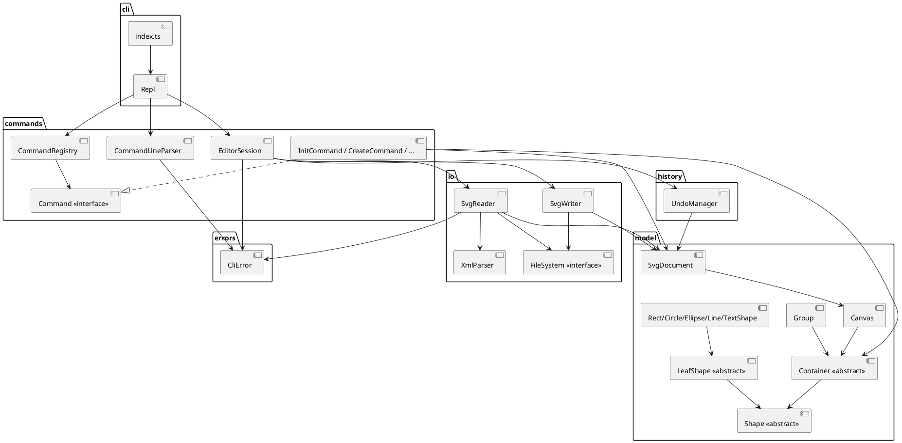

# Lab1 Phase 1：SVG 编辑器（CLI）——架构方案

> 本文档是开发过程中的活文档：第 1 节「架构方案」在编码前先行确定，
> 第 2～4 节在实现过程中与最终验收时补齐。提交历史与本文档相互印证。

## 1. 架构方案

### 1.1 需求约束回顾

- TypeScript + 面向对象：类层次 + 多态、字段封装、一类一文件（文件名 = 类名）；
- 禁止贫血模型 + 过程式自由函数 + 到处 `switch(tag)` 分派；
- 必须使用 Command 模式；容器与叶子图形统一操作（Composite 语义）；
- 按名字分派只允许两处：命令分发（命令名 → 实现）、图形工厂（类型名 → 类），
  并须标注为待重构点。

### 1.2 模块划分

| 目录 | 职责 | 主要内容 |
|---|---|---|
| `src/errors/` | 统一错误类型（最底层，被所有模块依赖） | `CliError`：所有面向用户的错误消息载体 |
| `src/model/` | 领域模型：图形对象、类层次、容器树、文档根、几何与属性语义 | `Shape`（抽象基类）、`LeafShape`、`Rect` / `Circle` / `Ellipse` / `Line` / `TextShape`、`Container`、`Group`、`Canvas`、`SvgDocument`、`Point`、数值格式化工具 |
| `src/io/` | 与外部世界交换数据：SVG 文本序列化 / 反序列化、文件访问抽象 | `XmlElement` / `XmlParser`、`SvgWriter`、`SvgReader`、`FileSystem` 接口与 `NodeFileSystem` |
| `src/history/` | 撤销重做：每个编辑命令对应一个快照单元 | `UndoManager`（Memento 快照 + 禁止期锁定） |
| `src/commands/` | Command 模式落地：命令接口、命令实现、注册与分发、参数解析、会话编排 | `Command` 接口、`CommandRegistry`、`EditorSession`、`CommandLineParser`、`DocumentCommands` / `EditCommands` / `QueryCommands` 各具体命令类 |
| `src/cli/` | 交互层：REPL、提示符、输出适配、进程入口 | `Repl`、`src/index.ts` |
| `test/` | 自动化测试（编译后由 `node --test` 驱动） | 覆盖核心功能、边界、异常、回归场景 |

### 1.3 组件图（PlantUML）



### 1.4 设计模式

**1) Command 模式（核心）**

- `Command` 接口：`name`、`usage`、`description`、`category`（document / edit / query / history）、
  `run(args, session) → CommandResult`。
- 每个具体命令一个类（一类一文件），只做三件事：校验参数、调用领域对象、返回反馈文本。
- `CommandRegistry` 负责「命令名 → Command 实例」的分发（**允许的按名分派点之一**）。
- `EditorSession` 作为 Invoker：统一执行命令、负责快照、异常回滚、撤销单元登记与历史锁定。
  这样「一条编辑命令 = 一个 undo 单元」由会话层保证，具体命令不需要各自实现逆操作。
- 撤销重做本身也是命令（`UndoCommand` / `RedoCommand`），委托 `UndoManager` 完成。

**2) Composite 模式**

- `Shape` 为抽象组件；`LeafShape` 是叶子；`Container` 是组合节点，`Group` 是具体的 `g` 容器。
- `move` / `scale` / `set` / `delete` 等语义在基类/容器上多态实现：
  容器把操作递归下发到子节点（`move`、`scale`），命令只面向 `Shape` 编程，
  因此 `<g>` 与 `rect` 等对命令层完全一致。

**3) Memento（快照式撤销）**

- `SvgDocument.snapshot()` 深拷贝整棵图形树；`UndoManager` 保存
  `before` / `after` 快照与操作摘要。相比「每个命令实现逆操作」，
  快照方案让 `group` / `ungroup` / `addto` / `delete` 等结构变更天然成为一个原子单元，
  也天然满足「命令失败不改变任何状态」（失败即回滚到 before 快照）。
- 代价是内存占用，对 CLI 规模（数百图形）可接受，属于有意取舍。

**4) Factory（图形工厂）**

- `ShapeFactory`（`src/commands/factories/`）按类型名创建六种内置图形，从参数 token 解析
  各自几何参数（**允许的按名分派点之二**，标注为待重构：后续插件化阶段会替换为
  `ShapeProvider` 注册表）。

### 1.5 依赖方向规则

```
errors ← model ← io ← commands ← cli
             ← history ← commands
```

| 允许的依赖 | 理由 |
|---|---|
| `model → errors` | 领域对象需要抛出统一错误（如属性白名单校验） |
| `io → model, errors` | 读写器必须认识图形对象 |
| `history → model` | 快照保存的是文档对象 |
| `commands → model, io, history, errors` | 命令是应用的编排层 |
| `cli → commands` | 交互层只面向命令层，不直接操作领域对象 |

禁止的依赖（违反即待处理项）：

- `model` 不得依赖 `commands` / `cli` / `io` / `history`（领域层保持纯净，可独立测试）；
- `io`、`history` 不得依赖 `commands` / `cli`；
- 具体命令类不得互相依赖（跨命令复用一律下沉到 `model` 或 `session` 的公共能力）；
- `cli` 不得绕过 `EditorSession` 直接改文档。

检查手段：`scripts/check-layering.mjs` 静态扫描 `src/**` 的 `import` 路径并断言上述规则
（该脚本在阶段 6 加入，见「一致性自查」）。

### 1.6 变化点假设

| 变化点 | 假设 | 是否为它留了扩展点 |
|---|---|---|
| 图形类型扩展（插件化 `box` 等） | 后续阶段会引入 `ShapeProvider` 插件注册表 | 是：工厂集中在 `ShapeFactory` 一处；`Container` 可被 `box` 继承；`ungroup` 在 `Group` 上留 `canUngroup()` 钩子 |
| 命令语法扩展 | 命令参数会随需求增加 | 是：解析与校验在每个命令类内部，新增命令只需注册 |
| 查询/显示格式 | `tree`/`show` 的排版可能调整 | 是：格式生成收敛在 `Shape.describeInline()` / `describeDetails()` 中 |
| 序列化格式（data-kind 等） | 插件类型需要序列化标记 | 部分：`Shape` 提供 `extraAttributes()` 钩子，本阶段内置类型返回空 |
| 存储后端 | 可能从本地文件改为其他持久化 | 是：`FileSystem` 为接口，`NodeFileSystem` 是唯一实现，测试用内存实现 |
| undo 策略 | 若图形数量爆炸，快照会变重 | 否（有意）：本阶段规模小，Memento 换取实现简单与正确性；若将来性能成为问题，可在 `UndoManager` 内部替换为命令逆操作，不影响命令层接口 |

> 说明：本文件在阶段 1 只写「架构方案」；过程记录、一致性自查、质量保证手段
> 在后续阶段随真实开发补充（见后续修订）。

## 2. 过程记录

（待实现阶段补充）

## 3. 一致性自查

（待最终验收阶段补充）

## 4. 质量保证手段

（待最终验收阶段补充）
